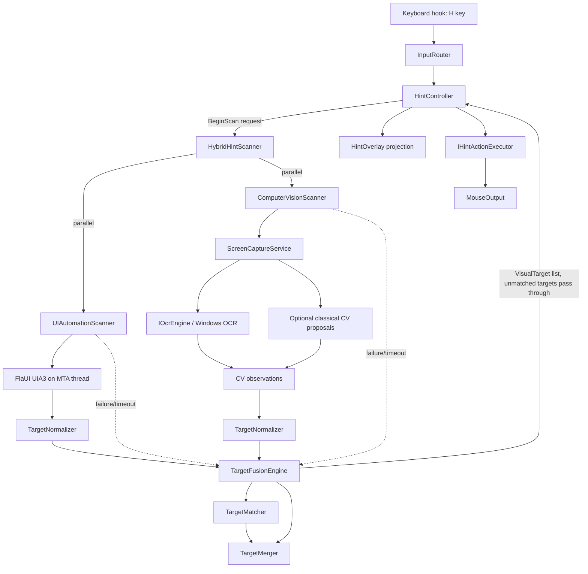

# Hybrid UIA + Computer Vision Hint Architecture

**Status:** Architecture audit / proposed design. No application behavior is changed by this document.  
**Baseline:** KeyboardMouse v1.0.9, commit `8554828`, clean worktree.  
**Scope:** Hint mode only. Grid mode, precision mode, movement, activation, and input routing remain behaviorally unchanged except for the scanner/action seams explicitly described below.

---

## 1. Current Architecture

### 1.1 Verified inventory

The current Hint implementation is real and is wired through the following files. Every item below was checked in the repository; this section does not assume classes that do not exist.

| Area | File | Current role |
|---|---|---|
| Hint session / interaction | `src/KeyboardMouse/Controllers/HintController.cs` | Owns active/scanning state, labels, typed prefix, Backspace/Esc, Shift-hover, Ctrl/F right-click, and the mouse move/click. |
| Scanner port | `src/KeyboardMouse/Core/IClickableScanner.cs` | `BeginScan(hwnd, options, completed, timedOut)` callback contract. |
| Scanner implementation | `src/KeyboardMouse/Hints/ClickableScanner.cs` | FlaUI UIA3 scan on a dedicated MTA thread with a 400 ms timer. |
| Scan options | `src/KeyboardMouse/Core/IClickableScanner.cs` | `HintScanOptions(MaxElements, IncludeTaskbar)`. |
| Target model | `src/KeyboardMouse/Core/ClickableTarget.cs` | `ClickableTarget(Bounds, Name)` plus `RawClickableTarget` and `HintTargetFilter`. |
| Labels | `src/KeyboardMouse/Core/HintLabels.cs` | Fixed-length, prefix-free home-row labels. |
| Overlay contract | `src/KeyboardMouse/Overlays/IHintOverlay.cs` | `ShowScanning`, `Show`, `Hide`. |
| Overlay implementation | `src/KeyboardMouse/Overlays/HintOverlay.cs` | One layered window per monitor; yellow label at target top-left; non-matching labels fade. |
| Overlay base | `src/KeyboardMouse/Overlays/OverlayForm.cs` | Layered, click-through, no-activate, topmost window with a DIB surface. |
| Input routing | `src/KeyboardMouse/Input/InputRouter.cs` | Owns controllers, priority, mode shutdown, button release. |
| Mouse output | `src/KeyboardMouse/Output/MouseOutput.cs` | SendInput absolute moves in virtual-desktop coordinates; button tracking; `ReleaseAll`. |
| Monitor geometry | `src/KeyboardMouse/Core/Monitors.cs` | Physical-pixel monitor rectangles, work areas, effective DPI, virtual bounds, clamping. |
| Grid | `src/KeyboardMouse/Controllers/GridController.cs`, `Core/GridMath.cs`, `Overlays/GridOverlay.cs` | Independent 3×3 grid navigation. Not part of the hint pipeline. |
| Precision | `src/KeyboardMouse/Controllers/NormalController.cs`, `Core/SpeedProfiles.cs`, `Core/MovementEngine.cs` | `S` hold layer selects the precision speed profile. Independent of hints. |
| Settings | `src/KeyboardMouse/Config/Settings.cs` | `HintSettings` with `Alphabet`, `MaxElements`, `IncludeTaskbar`; no scanner mode, OCR, or CV fields today. |
| Composition root | `src/KeyboardMouse/TrayApp.cs` | Constructs `Monitors`, `ClickableScanner`, `HintOverlay`, and `InputRouter`; supplies UI dispatch. |
| Project | `src/KeyboardMouse/KeyboardMouse.csproj` | `net8.0-windows`, WinForms, PerMonitorV2, `FlaUI.UIA3 5.0.0`, `Microsoft.Web.WebView2`; version `1.0.9`. |

**Verified absent today:** `IHintScanner`, `UIAutomationScanner`, `ComputerVisionScanner`, `ScreenCaptureService`, `IOcrEngine`, `VisualTarget`, `TargetNormalizer`, `TargetFusionEngine`, `TargetMatcher`, `TargetMerger`, `IHintActionExecutor`, and `HybridHintScanner` do not exist in the repository. The current equivalents are `IClickableScanner`, `ClickableScanner`, and `ClickableTarget`; there is no OCR, screen-capture, or CV code.

**Verified present today:** `ClickableScanner`, `IClickableScanner`, `ClickableTarget`, `HintTargetFilter`, `HintLabels`, `HintController`, `IHintOverlay`, `HintOverlay`, `OverlayForm`, `MouseOutput`, `IMouseOutput`, `Monitors`, `IMonitorService`, `GridController`, `GridMath`, `NormalController`, `MovementEngine`, and `SpeedProfiles` all exist at the paths listed above.

### 1.2 Current Hint flow

1. `H` is mapped by `NormalController` to `HintController.Open()`; `InputRouter` gives `HintController` priority while it is active.
2. `HintController.Open()` sets `_active`, `_scanning`, clears labels/typed text, increments `_scanVersion`, and posts `StartScan` to the UI thread through `dispatch`.
3. `StartScan` shows `HintOverlay.ShowScanning(currentMonitor, "Scanning...")`, captures the foreground window handle, builds `HintScanOptions` (`MaxElements` clamped 1–2000; `IncludeTaskbar`), and calls `IClickableScanner.BeginScan`.
4. `ClickableScanner` starts a 400 ms `System.Threading.Timer` and a background **MTA** thread. The thread creates a `UIA3Automation`, opens the foreground `hwnd` and optionally `Shell_TrayWnd`, calls `FindAllDescendants()`, and collects elements that:
   - are not offscreen and are enabled;
   - are one of the wanted control types, or support the Invoke pattern;
   - have a non-empty bounding rectangle.
5. `HintTargetFilter.Apply` drops invalid/disabled/offscreen targets, intersects each target with a monitor, clips to the first intersecting monitor, deduplicates by center within 4 px, caps at `MaxElements`, and sorts top-to-bottom/left-to-right.
6. If no targets were found and less than 200 ms elapsed, `ClickableScanner` sleeps 150 ms and retries once. This is the Chromium/Electron lazy-accessibility workaround.
7. The completion callback is dispatched to the UI thread. `HintController.FinishScan` stores targets, generates labels with `HintLabels.Generate`, and calls `HintOverlay.Show`.
8. Typing a label prefix updates the overlay; a complete label calls `Activate`, which clamps the target center to the desktop, moves the pointer with `IMouseOutput.MoveTo`, and left-clicks, right-clicks, or hovers. Then the hint set closes.
9. `Esc`, leaving mouse mode, a timeout, or an empty result closes the hint set. The `_scanVersion` token makes late results harmless.

### 1.3 Existing dependency graph

```text
TrayApp
├─ SettingsStore ── Settings
├─ Monitors ── IMonitorService
├─ MouseOutput ── IMouseOutput
├─ KeyboardHook
│   └─ InputRouter
│       ├─ ActivationController ── AppState
│       ├─ HintController
│       │   ├─ IClickableScanner ── ClickableScanner ── FlaUI.UIA3 ── UIA3 COM
│       │   ├─ IHintOverlay ── HintOverlay ── OverlayForm ── User32/Gdi32
│       │   ├─ HintLabels
│       │   ├─ IMouseOutput
│       │   └─ IMonitorService
│       ├─ GridController
│       │   ├─ IGridOverlay ── GridOverlay ── OverlayForm
│       │   ├─ GridMath
│       │   ├─ IMouseOutput
│       │   └─ IMonitorService
│       ├─ PendingController ── IMarkStore
│       └─ NormalController
│           ├─ MovementEngine ── IMouseOutput
│           └─ SpeedProfiles / SpeedProfile
└─ Overlays: CursorIndicator, ScreenBorder, GridOverlay, HintOverlay
```

External dependencies today:

- `FlaUI.UIA3 5.0.0` (and transitive `FlaUI.Core`) for UI Automation.
- `Microsoft.Web.WebView2 1.0.4314.35` for the guide window only; it is not involved in hints.
- .NET 8 WinForms, `System.Drawing`, `System.Text.Json`.
- Hand-written P/Invoke in `src/KeyboardMouse/Native/` for User32, Gdi32, DWM, Shcore, and input structures.

There is currently **no** screen-capture, OCR, OpenCV, or computer-vision dependency. A repository search found no `CopyFromScreen`, `OpenCv`, `Tesseract`, `Windows.Media.Ocr`, `OcrEngine`, or screen-capture code.

### 1.4 Current coordinate conventions

- `Monitors` enumerates monitors with `EnumDisplayMonitors` / `GetMonitorInfoW`; `MonitorInfo.Bounds` and `WorkArea` are in **physical pixels** in the Windows virtual-desktop coordinate space. `Monitors.All` is sorted by left/top.
- `MonitorInfo.Scale` comes from `Shcore.GetDpiForMonitor(MDT_EFFECTIVE_DPI)` and is used for overlay font sizing, not for geometry.
- `HintTargetFilter` treats UIA `BoundingRectangle` values as physical pixels. The app is PerMonitorV2 (`app.manifest` and `Program.cs`), so this is the intended invariant.
- `HintOverlay` positions each overlay at `monitor.Bounds.Left/Top` and subtracts those values when drawing labels. It draws a target on every monitor whose bounds intersect the target.
- `MouseOutput.MoveTo(x, y)` maps physical virtual-desktop pixels to the 0–65535 absolute range using `SM_XVIRTUALSCREEN`, `SM_YVIRTUALSCREEN`, `SM_CXVIRTUALSCREEN`, `SM_CYVIRTUALSCREEN`, with `MOUSEEVENTF_ABSOLUTE | MOUSEEVENTF_VIRTUALDESK`.
- `Monitors.ClampToDesktop` clamps into the virtual desktop and then into the nearest real monitor, so pointer positions never land in gaps between mixed-size/mixed-DPI monitors.
- `GridController` and `GridMath` use the same physical-pixel rectangles. Precision mode does not change coordinate systems; it only changes the movement speed profile.

### 1.5 Current limitations relevant to the migration

- UIA-only scanning cannot see custom-drawn controls, games, many canvas apps, or some Electron/Chromium surfaces until the accessibility tree is built.
- The current 400 ms timeout returns control to the UI, but the UIA thread is not forcibly stopped; it may continue in the background and its result is ignored. This is safe for the hook/UI but is not cooperative cancellation.
- `ClickableTarget` is a presentation/raw hybrid: it has bounds and a name, but no source, confidence, provenance, OCR text, or action metadata. It cannot represent a CV observation cleanly.
- `HintController` embeds mouse movement/click policy. There is no `IHintActionExecutor` seam today.
- There is no scanner mode: UIA is the only scanner, and there is no way to run CV-only or hybrid.
- `HintOverlay` and `HintLabels` already work well and should be preserved; only the target source and activation path need to change.
- Hint settings are not exposed in the guide UI today; they are read from `settings.json`. `TrayApp.ApplyGuideSetting` handles feedback, auto-click, and update settings, not `HintSettings`.

### 1.6 Existing tests and project structure

- 19 test files in `tests/KeyboardMouse.Tests`; 175 `[Fact]` and 10 `[Theory]` attributes. The last full run reported 215 passing tests.
- Direct hint coverage:
  - `HintControllerTests.cs`: 16 facts covering scan start, labels, click center, Shift-hover, Ctrl/F right-click, Backspace, non-matching letters, Esc, late results, timeout, empty scan, mode exit, remapping, and settings/monitor pass-through.
  - `HintTargetFilterTests.cs`: 6 facts covering filtering, clipping, deduplication, ordering, and cap.
  - `HintLabelsTests.cs`: 7 facts covering alphabet/length/prefix-free behavior.
- `RouterHarness` in `tests/KeyboardMouse.Tests/TestDoubles.cs` constructs the real `InputRouter` with fake mouse, movement, scanner, overlay, monitors, foreground, cursor, and dispatcher. `FakeHintScanner` currently records the `IClickableScanner` call and exposes `Complete` / `Timeout`.
- Grid and precision coverage lives in `GridControllerTests.cs`, `GridMathTests.cs`, `LayerTests.cs`, and `SpeedProfileTests.cs`. These must remain behaviorally unchanged.
- The release workflow builds a single-file, self-contained `win-x64` executable and zips it with a SHA256. Any new native dependency (OpenCV) or WinRT dependency (Windows OCR) has to be validated against that publish path.

---

## 2. Audit Conclusions

1. **The current Hint pipeline is small and well-isolated.** `HintController`, `HintLabels`, `HintOverlay`, and `MouseOutput` can be retained. The main missing seam is between the controller and the scanner.
2. **A new scanner abstraction is required.** The existing `IClickableScanner` callback shape is usable, but the target type must become `VisualTarget` and the result must carry source diagnostics and partial results.
3. **UIA and CV must be separate source implementations.** Neither source may call the other. `HybridHintScanner` is the only component that knows both exist.
4. **Fusion must be additive, not gating.** A target found by only one source is valid and must be displayed. Fusion enriches matches and removes duplicates; it must never require two sources to agree before a label appears.
5. **The existing coordinate convention is already the right one.** Physical pixels in the Windows virtual-desktop space are the canonical space. CV must be normalized into that space; do not introduce a DIP-based or per-monitor-local target model.
6. **No AI model is justified yet.** The initial CV baseline is local screen capture + offline OCR + classical geometry. An LLM/VLM or downloadable model is explicitly out of scope until measurements show the OCR/classical baseline is insufficient.
7. **The migration can be behavior-neutral for several phases.** Keep UIA-only as the default until the hybrid pipeline passes parity and performance gates.

---

## 3. Proposed Architecture

### 3.1 Design principles

- Preserve the current Hint interaction: `H`, typed labels, Backspace, Esc, Shift-hover, Ctrl/F right-click, label fading, and overlay placement.
- Preserve Grid and Precision code paths. Do not route grid or movement through the new scanner.
- Keep UIA and CV independent. A failure, timeout, or missing dependency in one source must not disable the other.
- Keep the keyboard hook and UI thread free of scan work. UIA stays on an MTA worker; CV runs on a separate worker; fusion is CPU-only and short.
- All captures and OCR remain local. No screenshot or OCR text is uploaded, logged, or persisted by default.
- Prefer deterministic, testable components over framework-heavy abstractions.
- Make UIA-only, CV-only, and Hybrid selectable by configuration.

### 3.2 Target component map

```text
HintController
  └─ IHintScanner
       └─ HybridHintScanner
            ├─ UIAutomationScanner ──────────────┐
            │                                     │
            ├─ ComputerVisionScanner              │
            │    ├─ ScreenCaptureService          │
            │    ├─ IOcrEngine                    │
            │    └─ optional classical detector   │
            │                                     │
            ├─ TargetNormalizer (UIA result) ─────┤
            ├─ TargetNormalizer (CV result) ──────┤
            └─ TargetFusionEngine                 │
                 ├─ TargetMatcher ────────────────┤
                 └─ TargetMerger ─────────────────┘
                      │
                      ▼
              IReadOnlyList<VisualTarget>
                      │
          ┌───────────┴────────────┐
          ▼                        ▼
   HintOverlay projection     IHintActionExecutor
   (existing UI)              └─ IMouseOutput
```

### 3.3 Component responsibilities and dependencies

| Component | Responsibility | Depends on | Must not depend on |
|---|---|---|---|
| `IHintScanner` | Controller-facing scan port. Accepts a `HintScanRequest` (foreground window, options, mode, budget), calls back exactly once with `HintScanResult` or a failure. No UI access. | `VisualTarget`, scan request/result types | Overlays, WinForms, UIA/CV implementations |
| `UIAutomationScanner` | UIA3 implementation. Opens the foreground window and optional taskbar on an MTA thread, enumerates descendants, applies UIA-specific eligibility rules (control type, Invoke support, offscreen/enabled), and emits raw UIA observations. Enforces the existing 400 ms budget and lazy-tree retry. | FlaUI.UIA3, `IMonitorService`, `HintScanOptions`, logging | ComputerVisionScanner, TargetFusionEngine, overlays |
| `ComputerVisionScanner` | Independent visual scanner. Captures the scan regions, runs OCR and optional classical proposals, groups words/lines into candidates, and emits raw CV observations. Never calls UIA. | `ScreenCaptureService`, `IOcrEngine`, optional OpenCV detector, `IMonitorService`, logging | UIAutomationScanner, TargetFusionEngine, overlays |
| `ScreenCaptureService` | Captures the foreground window region (and optional taskbar) per monitor at native physical resolution; returns in-memory frames with desktop bounds, stride, and scale metadata. Excludes the app's overlay windows from capture. Never writes files. | Win32 GDI/DWM/User32, `IMonitorService` | OCR, UIA, fusion |
| `IOcrEngine` | Offline OCR abstraction. Returns text lines/words with frame-local bounding boxes. Implementations may be unavailable; callers must degrade gracefully. | Platform OCR API or local OCR package | UIA, fusion, network |
| `WindowsMediaOcrEngine` | Recommended first `IOcrEngine`: Windows' built-in offline OCR (`Windows.Media.Ocr`), no model download, no network. Returns empty/not-available if the OS language pack is missing. | Windows OCR API, local language packs | Network, UIA |
| `VisualTarget` | Canonical shared target model. Immutable record with physical-pixel bounds, activation point, source flags, kind, confidence, provenance, monitor/DPI metadata, and optional in-memory name/text. | `System.Drawing` value types only | Scanners' internal types |
| `TargetNormalizer` | Converts raw source observations into canonical `VisualTarget`s: coordinate conversion, monitor clipping, visibility/enabled filtering, activation-point calculation, source-local deduplication, confidence assignment, ordering, and source-local cap. Does not compare UIA and CV. | `IMonitorService`, scan metadata, `VisualTarget` | Scanners, fusion, UI |
| `TargetFusionEngine` | Orchestrates matching and merging. Accepts normalized UIA and CV lists; if either is empty/failed, returns the other unchanged. Produces the final target list and diagnostics. Pure and deterministic. | `TargetMatcher`, `TargetMerger`, `VisualTarget` | I/O, UIA, CV, UI |
| `TargetMatcher` | Finds plausible UIA/CV pairs using geometry, containment, center distance, size ratio, and optional text similarity. Uses a spatial index and deterministic one-to-one assignment. Never drops unmatched targets. | `VisualTarget` geometry | I/O, OCR, UI |
| `TargetMerger` | Builds a fused target from a match, fills names/kinds, combines confidence, suppresses redundant text-only duplicates inside a UIA control, passes through unmatched targets, deduplicates, orders, and applies the final cap. | `VisualTarget` | I/O, OCR, UI |
| `IHintActionExecutor` | Executes a target action (left click, right click, hover) by moving to the target's activation point and using `IMouseOutput`. Preserves current hover/right-click semantics and safety clamping. | `IMouseOutput`, `IMonitorService` | Scanner, fusion, UI |
| `HybridHintScanner` | Implements `IHintScanner`. Selects UIA-only/CV-only/Hybrid, runs sources in parallel with independent failure isolation and a shared deadline, normalizes each result, calls fusion, and returns one result. | UIAutomationScanner, ComputerVisionScanner, TargetNormalizer, TargetFusionEngine, settings, clock | UI, overlays, keyboard hook |
| `HintController` (retained) | Session/interaction owner. Keeps typed-prefix logic, labels, Shift/Ctrl/F semantics, and overlay calls. Switches from `IClickableScanner`/`ClickableTarget` to `IHintScanner`/`VisualTarget` and delegates activation to `IHintActionExecutor`. | `IHintScanner`, `IHintOverlay`, `HintLabels`, `IHintActionExecutor`, `IMonitorService` | UIA, CV, OCR |
| `HintLabels` (retained) | Generates labels after fusion. Unchanged. | None | Scanners |
| `HintOverlay` (retained) | Draws labels from a lightweight `ClickableTarget` projection of `VisualTarget`; no rewrite required. | `ClickableTarget`, `MonitorInfo` | UIA, CV |
| `MouseOutput` (retained) | Absolute virtual-desktop SendInput and button tracking. Unchanged. | Win32 | Scanners |
| `GridController` / `GridMath` / `GridOverlay` (retained) | Unchanged 3×3 grid and precision-adjacent behavior. | Existing dependencies | New hint pipeline |
| `InputRouter` (small change) | Keeps controller priority and mode shutdown. Scanner parameter type changes to `IHintScanner`; no priority/behavior change. | `IHintScanner` | CV/UIA details |
| `TrayApp` (composition change) | Constructs the new scanner stack and owns disposal. No UI redesign required. | New components, settings | None |

### 3.4 Threading model

| Work | Thread | Rules |
|---|---|---|
| Keyboard hook, router, overlays, guide | UI thread (WinForms message loop) | Must stay under ~1 ms per key event. No UIA, capture, OCR, or fusion here. |
| UIA enumeration | Dedicated MTA background thread | FlaUI/UIA3 COM calls stay on one MTA thread. Cannot be forcibly aborted; check cancellation between elements and ignore late results. |
| Screen capture + OCR + classical CV | Background worker/task | Per-monitor cancellation checks; no UI or overlay access. |
| Fusion | Short CPU work on the coordinator thread or a worker | Pure, bounded, deterministic. Typical budget < 10 ms for 400×400 candidates with a spatial index. |
| Overlay updates | UI thread through the existing `dispatch` callback | Preserve `HintController`'s existing dispatch wrapping. |

`HybridHintScanner` must invoke its completion callback exactly once, even if a source throws, times out, or is canceled. The controller's existing `_scanVersion` guard remains the final defense against late results. A scanner instance should support only one active scan at a time: starting a new scan cancels the previous cancellation token and ignores its result. OCR engines are created per scan or serialized, because not every platform OCR engine is re-entrant.

### 3.5 Suggested interface shapes

These are design-level signatures, not implementation code. Names and exact constructor injection can be adjusted during implementation.

```csharp
public enum HintScannerMode
{
    UiaOnly,
    ComputerVisionOnly,
    Hybrid
}

public sealed record HintScanRequest(
    IntPtr ForegroundWindow,
    HintScanOptions Options,
    HintScannerMode Mode,
    TimeSpan Budget);

public sealed record HintScanResult(
    IReadOnlyList<VisualTarget> Targets,
    HintScanDiagnostics Diagnostics);

public sealed record HintScanDiagnostics(
    HintScannerMode Mode,
    int UiaCandidates,
    int CvCandidates,
    int FusedTargets,
    int MatchedPairs,
    int SuppressedDuplicates,
    long UiaMs,
    long CaptureMs,
    long OcrMs,
    long CvMs,
    long FusionMs,
    bool UiaFailed,
    bool CvFailed,
    bool OcrUnavailable,
    string? FailureReason);

public interface IHintScanner
{
    void BeginScan(
        HintScanRequest request,
        Action<HintScanResult> completed,
        Action<HintScanFailure> failed);
}
```

`HintScanFailure` is reserved for a total failure where no usable result exists. A partial result from one source is a **successful** `HintScanResult`, not a failure. This is what makes "one scanner fails, the other still works" explicit.

Source implementations can share an internal source contract:

```csharp
internal interface IHintScanSource
{
    string Name { get; }
    Task<HintScanSourceResult> ScanAsync(HintScanRequest request, CancellationToken cancellationToken);
}
```

`UIAutomationScanner` and `ComputerVisionScanner` implement `IHintScanSource`; `HybridHintScanner` composes them. Tests can substitute fake sources without touching UIA or OCR.

### 3.6 Computer-vision baseline

The initial CV source is deliberately narrow and deterministic. It does not add a learned UI-element model to the app.

1. **Capture** the foreground window region per intersecting monitor at native physical resolution (plus the optional taskbar region).
2. **Text proposals:** run the offline OCR engine and group words into lines/phrases. Each OCR line becomes a candidate with a frame-local bounding box, text, and a confidence derived from OCR confidence (when available), line height, character count, and local contrast.
3. **Geometry proposals (optional, measured):** convert the frame to grayscale, run edge/threshold detection, find contours, approximate polygons, and keep compact rectangles with plausible size, aspect ratio, contrast, and border/fill evidence. This is classical OpenCV-style detection, not a neural network. It targets icon-only buttons and custom-drawn controls that OCR cannot name.
4. **Filter:** drop tiny/huge regions, paragraph-like text blocks, low-contrast boxes, and duplicates. Prefer line-level candidates over individual words so one label represents one visual control. Cap CV candidates before fusion.
5. **Never call UIA.** CV output is only a set of visual observations; UIA remains a completely separate source.

The only OCR model involved is the one already shipped with Windows (or a local OCR package if measurements justify it). No LLM/VLM, no downloaded model, no cloud call. If Windows OCR is unavailable, the CV source degrades to geometry-only (if enabled) or returns empty; UIA continues normally. Do not add OpenCV or Tesseract until Phase 0 measurements show the simpler path is insufficient; both have single-file publish, binary-size, and model-file implications.

### 3.7 Settings additions

Additive fields in `HintSettings`:

```csharp
public sealed class HintSettings
{
    public string Alphabet { get; set; } = "asdfjkl;";
    public int MaxElements { get; set; } = 400;
    public bool IncludeTaskbar { get; set; } = true;

    // New in the hybrid work.
    public string ScannerMode { get; set; } = "uia"; // "uia" | "cv" | "hybrid"
    public double CvMinConfidence { get; set; } = 0.45;
    public bool CvEnableOcr { get; set; } = true;
    public int ScanBudgetMs { get; set; } = 600;
}
```

`ScanBudgetMs` is the overall hybrid deadline. `UIAutomationScanner` keeps its existing 400 ms internal cap, and the CV source has its own cancellation-aware budget inside the overall deadline. `Settings.Normalize()` must:

- map unknown `ScannerMode` values to `"uia"`;
- clamp `CvMinConfidence` to a safe range (for example 0.1–0.95);
- clamp `ScanBudgetMs` to a safe range (for example 300–1500);
- preserve v1.0.9 settings files unchanged because missing fields take their defaults.

Default policy: keep `"uia"` as the default during the behavior-neutral phases. Switch the default to `"hybrid"` only after the acceptance gates in section 10.2 pass. This avoids changing existing users' hint behavior during the migration.

No scanner mode UI is required for the first implementation. The existing guide does not expose `HintSettings`; adding a mode control later is an optional UI change, not part of the core migration.

### 3.8 Preserved behavior and non-goals

Preserved exactly:

- `H` opens hints, `Esc` closes them, `Backspace` edits the prefix, and labels are fixed-length/prefix-free from `HintLabels`.
- Shift-hover, Ctrl/F right-click, normal left-click, and close-after-activation.
- `HintOverlay` label placement, fading, scanning message, and monitor coverage.
- `GridController`, `GridMath`, `GridOverlay`, `MovementEngine`, `SpeedProfiles`, and the `S` precision layer.
- `InputRouter` controller priority: Hint > Grid > Pending > Normal; mode exit/panic releases all buttons.
- `MouseOutput` absolute virtual-desktop movement and button tracking.
- `Program.cs`, `app.manifest` PerMonitorV2 DPI awareness, single-instance behavior, and release packaging.

Non-goals for this migration:

- Rewriting the hint overlay or label system.
- Changing Grid or Precision interaction.
- Using UIA `InvokePattern` as the default action path.
- Adding a cloud OCR/vision service, telemetry, or screenshot persistence.
- Adding an LLM/VLM or downloadable UI-detection model before measurements justify it.
- Supporting secondary taskbars or a redesigned settings page in the first pass.

---

## 4. Data Flow Diagram

### 4.1 Current flow

```text
H key
  └─ InputRouter
       └─ NormalController callback
            └─ HintController.Open
                 ├─ dispatch to UI: ShowScanning
                 └─ ClickableScanner.BeginScan
                      ├─ 400 ms timer
                      └─ MTA thread: UIA3Automation
                           ├─ foreground hwnd + optional Shell_TrayWnd
                           ├─ FindAllDescendants
                           └─ HintTargetFilter (clip/dedupe/cap/order)
                 └─ completed -> dispatch UI -> FinishScan
                      ├─ HintLabels.Generate
                      └─ HintOverlay.Show
                           └─ typed label -> Activate
                                ├─ Monitors.ClampToDesktop
                                ├─ MouseOutput.MoveTo
                                └─ LeftClick / RightClick / hover
```

### 4.2 Proposed hybrid flow



The dotted failure paths are deliberate: a failed source contributes an empty list and diagnostics, not a global failure. The other source continues and its targets are displayed. Agreement is never a prerequisite for display.

### 4.3 Recommended scan sequence

1. `HintController` validates `_active`, increments the scan version, and posts `StartScan` to the UI thread.
2. `HintController` asks `IHintScanner` to begin a scan with the foreground handle and settings. The scanning overlay may be shown immediately; the CV capture path excludes the app's overlay windows from capture.
3. `HybridHintScanner` starts both source scans concurrently. Each source has its own internal deadline and exception boundary.
4. `UIAutomationScanner` produces raw UIA observations, already limited to eligible controls and the existing 400 ms budget.
5. `ComputerVisionScanner` captures the foreground window regions, runs OCR and optional classical proposals, and produces raw CV observations. It never calls UIA.
6. `TargetNormalizer` converts each source's observations to canonical physical-pixel `VisualTarget`s, clips/filters/dedupes per source, and assigns source confidence.
7. `TargetFusionEngine` runs `TargetMatcher` and `TargetMerger`. Matched pairs become enriched targets; unmatched UIA and CV targets pass through. Redundant text-only duplicates inside strong UIA controls may be suppressed.
8. `HybridHintScanner` returns one `HintScanResult` with diagnostics.
9. `HintController` stores the targets, generates labels in final spatial order, and projects them to `ClickableTarget` for the existing `HintOverlay`.
10. A completed label calls `IHintActionExecutor.Execute(target, action)`, which moves to `target.ActivationPoint` and clicks/hovers. The controller closes the hint set as before.

---

## 5. VisualTarget Schema

`VisualTarget` is the only target type that crosses the scanner/fusion/controller/action boundaries. It is immutable and uses physical pixels in the Windows virtual-desktop space.

```csharp
using System.Drawing;

namespace KeyboardMouse.Core;

[Flags]
public enum TargetSource
{
    None = 0,
    Uia = 1 << 0,
    CvOcr = 1 << 1,
    CvContour = 1 << 2
}

public enum VisualTargetKind
{
    Unknown,
    Button,
    Hyperlink,
    MenuItem,
    TabItem,
    ListItem,
    TreeItem,
    CheckBox,
    RadioButton,
    ComboBox,
    Edit,
    Text,
    Icon,
    Other
}

public sealed record VisualTarget
{
    /// <summary>Scan-local stable id. Never persisted.</summary>
    public required string Id { get; init; }

    /// <summary>Visible bounds in physical virtual-desktop pixels. Clipped to a monitor.</summary>
    public required Rectangle Bounds { get; init; }

    /// <summary>Physical pixel to move to before acting. Always inside Bounds.</summary>
    public required Point ActivationPoint { get; init; }

    public required TargetSource Sources { get; init; }
    public VisualTargetKind Kind { get; init; } = VisualTargetKind.Unknown;

    /// <summary>UIA accessible name. In-memory only; never log or serialize.</summary>
    public string? Name { get; init; }

    /// <summary>OCR text. In-memory only; never log or serialize.</summary>
    public string? Text { get; init; }

    /// <summary>Fused confidence in [0, 1].</summary>
    public double Confidence { get; init; }

    public double UiaConfidence { get; init; }
    public double CvConfidence { get; init; }

    public IntPtr MonitorHandle { get; init; }
    public double DpiScale { get; init; } = 1.0;

    public bool IsEnabled { get; init; } = true;
    public bool IsOffscreen { get; init; }
    public bool SupportsInvoke { get; init; }

    /// <summary>Optional UIA runtime id for diagnostics/future revalidation.</summary>
    public string? UiaRuntimeId { get; init; }

    /// <summary>Provenance in canonical physical pixels, for tests/diagnostics.</summary>
    public Rectangle? UiaBounds { get; init; }
    public Rectangle? CvBounds { get; init; }

    public int ScanId { get; init; }
    public int FrameId { get; init; }

    // Redact text from diagnostic output.
    public override string ToString() =>
        $"VisualTarget({Id}, {Bounds}, {Sources}, {Confidence:0.00})";
}
```

Schema notes:

- `Bounds` is always the **visible, clipped** rectangle used for the label. `UiaBounds`/`CvBounds` preserve the source geometry for diagnostics and tests but are never used for clicking.
- `ActivationPoint` is explicit because UIA may eventually provide a clickable point, while OCR/contour candidates use a box center. For v1, UIA uses the center of the clipped bounds to preserve current behavior.
- `TargetSource` is a flag set. A fused target has `Uia | CvOcr` or `Uia | CvContour`; a single-source target has one flag.
- `Name` and `Text` are optional and local-only. Do not add them to logs, `settings.json`, `marks.json`, crash messages, or diagnostics. `ToString()` intentionally omits them.
- `DpiScale` is metadata for sizing/OCR thresholds only. It is not used to convert `Bounds`; those are already physical pixels.
- `Id` is scan-local. It can be derived from source + runtime id or a deterministic hash of source/bounds; it is not a persistent identity across scans.
- Raw scanner observations can use internal types (`RawUiaTarget`, `RawCvTarget`, `CapturedFrame`) before `TargetNormalizer` creates `VisualTarget`s. This keeps coordinate conversion in one place.

---

## 6. Fusion Algorithm Proposal

### 6.1 Goals

- Preserve every UIA target. UIA is the structural, authoritative source and must not be lost because CV disagrees or fails.
- Add CV targets where UIA has gaps, especially custom-drawn/Electron/canvas UIs and icon-only controls.
- Merge overlapping observations into one label, not two.
- Never require agreement. A single-source target is valid.
- Be deterministic: same inputs produce the same target list, ordering, and labels.
- Be cheap enough to run on every hint scan without affecting the hook/UI.

### 6.2 Pipeline

```text
UIA observations ──> TargetNormalizer ──> UIA VisualTargets ─┐
                                                             ├─> TargetMatcher ──> TargetMerger ──> final list
CV observations  ──> TargetNormalizer ──> CV VisualTargets  ─┘
```

1. **Normalize each source independently.** Apply coordinate conversion, clipping, visibility/enabled checks, source-local dedupe, confidence assignment, source-local cap, and stable top/left ordering. Never compare UIA and CV here.
2. **If one source is empty or failed, return the other unchanged.** This is the explicit one-source fallback.
3. **Build a spatial index** per monitor (for example 64 px cells) over CV targets. Query cells that overlap each UIA target's bounds expanded by a small margin.
4. **Score candidate pairs.**
5. **Assign one-to-one matches** deterministically.
6. **Merge matches; pass through unmatched targets.**
7. **Suppress only clear redundant duplicates** (see below).
8. **Dedupe, sort, and cap** the final list. Labels are generated after this step, so labels never reorder mid-scan.

### 6.3 Pair scoring

For a UIA target `u` and a CV target `c`, require the same monitor assignment first. Then compute:

- `IoU = area(intersection) / area(union)`
- `IoS = area(intersection) / min(area(u), area(c))` (containment)
- `centerDistance` in physical pixels
- `sizeRatio = max(area(u) / area(c), area(c) / area(u))`
- `textScore` when both have text/name: normalized exact match = 1.0, high similarity = 0.8, partial = 0.4, conflict = 0.0. Use case-insensitive, whitespace-normalized comparison; optionally a bounded edit-distance ratio.

A pair is a **candidate** when at least one geometric condition holds:

```text
IoU >= 0.20
or IoS >= 0.60
or centerDistance <= max(6 px, 0.35 * min(u.Width, u.Height))
```

and `sizeRatio <= 6.0`. If both texts are non-empty and clearly conflict, require `IoU >= 0.50` to avoid merging unrelated controls that happen to overlap.

A simple score:

```text
geometry  = max(IoU, IoS * 0.90, 1 - centerDistance / maxDistance)
score     = 0.55 * geometry + 0.25 * IoS + 0.20 * textScore
```

If text is unavailable, redistribute the text weight across geometry/containment. Match when `score >= 0.45`. These thresholds are starting values; they should be tuned against a fixture set and covered by unit tests.

Starting source-confidence values (to be calibrated, not treated as truth):

| Observation | Base confidence |
|---|---|
| UIA wanted control type | 0.95 |
| UIA Invoke-only / unknown control type | 0.80 |
| OCR text line, strong height/contrast | 0.65–0.85 |
| OCR text line, weak/short | 0.35–0.60 |
| Classical contour, strong border/fill | 0.50–0.70 |
| Classical contour, weak geometry | 0.25–0.45 |

The CV scanner should not emit a candidate below `CvMinConfidence`. UIA targets are never filtered by `CvMinConfidence`; that setting applies only to CV observations.

### 6.4 Matching assignment

- Sort candidate pairs by score descending, then by `u.Id`, then `c.Id` for deterministic ties.
- Greedily assign one UIA target to one CV target. A CV target can be used once; a UIA target can be matched once.
- Do **not** require a perfect one-to-one matching algorithm for v1. Greedy with a spatial index is fast and predictable. If quality measurements show many ambiguous matches, evaluate a small Hungarian assignment for the affected region.
- Unmatched UIA and unmatched CV targets remain in the output.

### 6.5 Merging

For a matched pair:

| Field | Rule |
|---|---|
| `Bounds` | UIA bounds. UIA is the structural control; CV text boxes are often smaller and should not shrink the clickable label. |
| `ActivationPoint` | UIA activation point (center of clipped bounds) if present; otherwise CV center. |
| `Sources` | Union of both source flags. |
| `Kind` | UIA kind if known; otherwise CV kind (`Text`/`Icon`/`Unknown`). |
| `Name` | UIA name if non-empty; otherwise OCR text. |
| `Text` | OCR text when available, for diagnostics and future matching. In-memory only. |
| `Confidence` | Noisy-OR: `1 - (1 - u) * (1 - c * agreement)`, clamped. `agreement` is 0.5–1.0 from geometry/text. A single-source target keeps its source confidence. |
| `UiaBounds` / `CvBounds` | Preserve both for tests/diagnostics. |
| `MonitorHandle`, `DpiScale` | From the normalized UIA target, or CV target when UIA is absent. |

For unmatched targets: copy them through unchanged. A CV-only target is a valid result. A UIA-only target is a valid result. Fusion must not turn either into an empty list.

### 6.6 Duplicate suppression

The main duplicate risk is a large UIA list item/container whose text is also found by OCR. To avoid two labels for the same visual control:

- Keep unmatched CV targets unless they are **fully or almost fully contained** in a strong UIA target (`UiaConfidence >= 0.80`), are text-only (`CvOcr`, not `CvContour`), have no independent contour evidence, and the UIA target already has a non-empty name.
- If the UIA target is unnamed, keep the CV target: OCR may be the only useful label/name.
- If the CV observation has contour evidence (a button-like shape), keep it: it may be a child control UIA missed.
- Count suppressed targets in diagnostics; never silently drop without a test.

This is a quality rule, not an agreement rule: standalone CV targets are always kept.

### 6.7 Ordering and cap

- Final order: `Bounds.Top`, then `Bounds.Left`, then confidence descending, then a stable id. This preserves the current top-to-bottom/left-to-right label order.
- Final cap: `MaxElements` (default 400). If the fused list exceeds the cap, keep UIA-bearing targets first, then fill remaining slots with CV-only targets by confidence and spatial order. Then sort the selected set spatially for label assignment. This prevents CV extras from evicting valid UIA targets when the cap is tight.
- Source-local caps can also apply before fusion to bound work. The final cap is authoritative.
- Labels are generated only after the final list is stable. Do not insert/remove targets while the user is typing.

### 6.8 Worked examples

| Scenario | Result |
|---|---|
| UIA finds a button; CV finds the button's text inside it | One fused target, UIA bounds, UIA name preferred, confidence boosted. |
| UIA finds nothing; CV finds a toolbar label | One CV-only target. Displayed; no UIA agreement required. |
| UIA finds a custom-drawn canvas item; CV finds its text | One CV-only target (or a fusion match if bounds overlap); displayed. |
| UIA finds a large list item; OCR finds a paragraph line inside | Match if geometry/text agree; otherwise suppress the redundant text-only CV target only under the containment rule. |
| CV OCR is unavailable | UIA list passes through unchanged. No error dialog, no hint failure. |
| UIA times out | CV list passes through. If CV is also empty, the controller closes hints as it does today. |
| Both find the same button at slightly different bounds | Match; UIA bounds and activation point win. |

---

## 7. Action Execution Strategy

### 7.1 Current behavior to preserve

- `Shift` on the completing label means hover only.
- `Ctrl` or holding `F` means right-click.
- A normal complete label means left-click.
- The pointer moves to the target center, clamped to the virtual desktop/nearest monitor.
- Clicking closes the hint set; leaving mouse mode closes it and releases held buttons.

### 7.2 Proposed executor

```csharp
public enum HintAction
{
    LeftClick,
    RightClick,
    Hover
}

public interface IHintActionExecutor
{
    bool Execute(VisualTarget target, HintAction action);
}
```

`HintActionExecutor`:

1. Validates the target bounds and activation point.
2. Clamps the activation point with `IMonitorService.ClampToDesktop` (falling back to the target point when monitors are unavailable, as the current controller does).
3. Calls `IMouseOutput.MoveTo`.
4. For `LeftClick`/`RightClick`, calls the corresponding `IMouseOutput` click; for `Hover`, does not click.
5. Returns `false` for an invalid/empty target without moving or clicking.

`HintController` keeps the decision logic (`modifiers.Shift`, `modifiers.Ctrl`, `_fHeld`, and `keyEvent.Key == PhysicalKey.F`) and converts it to a `HintAction`, then calls the executor. This keeps interaction behavior in the controller and makes the output path testable.

### 7.3 UIA Invoke vs mouse click

**Default: mouse move + click for all targets.** Reasons:

- It preserves the current user experience and works identically for UIA and CV targets.
- It supports hover-only and right-click semantics, which `InvokePattern` does not.
- It avoids a second action policy and avoids apps where `Invoke` behaves differently from a physical click.
- CV targets have no UIA pattern, so a single mouse path is simpler and more predictable.

Optional future enhancement: if `VisualTarget.SupportsInvoke` is true, an opt-in policy could try `InvokePattern` first and fall back to a mouse click on failure. Do not make this the default until measured. The `IHintActionExecutor` seam makes that experiment local and reversible.

### 7.4 Safety

- Do not click if the target bounds are empty, offscreen, or entirely outside the virtual desktop.
- Do not click if the activation point cannot be clamped to a real monitor.
- `MouseOutput` already tracks pressed buttons and `ReleaseAll` is called on mode exit, panic, session lock, sleep, and unhandled exceptions. The executor must not bypass that tracking.
- If the foreground window changes between scan and activation, the click may land in the wrong app. Optional guard: compare the foreground handle at scan start and at completion; discard the result if it changed. At minimum, document and test the risk. A stale-target revalidation step can be added later using `UiaRuntimeId`/`SupportsInvoke` for UIA targets.

---

## 8. Coordinate System Strategy

### 8.1 Canonical space

**Canonical space = physical pixels in the Windows virtual-desktop coordinate system.** Origin is `(SM_XVIRTUALSCREEN, SM_YVIRTUALSCREEN)`, which may be negative. X grows right, Y grows down. A point is always `(int X, int Y)`; a rectangle is always `Rectangle(X, Y, Width, Height)`.

This is the same space already used by:

- `MonitorInfo.Bounds` / `WorkArea`;
- `ClickableTarget.Bounds`;
- `GridController` rectangles and `GridMath`;
- `MouseOutput.MoveTo` inputs;
- `HintOverlay` window placement.

No target, grid cell, screenshot region, or click point may be stored in DIPs, per-monitor-local coordinates, or normalized 0–1 coordinates. DPI scale is metadata for sizing and thresholds only.

### 8.2 Source-to-canonical conversions

| Source | Native coordinates | Conversion to canonical |
|---|---|---|
| UIA `BoundingRectangle` | Physical screen pixels for a PerMonitorV2 process | Validate intersection with the virtual desktop; clip to the selected monitor; keep `UiaBounds` provenance. No DPI division. |
| Screen capture frame | Frame-local pixels, top-left origin | `DesktopX = Frame.DesktopBounds.Left + localX / Frame.ScaleX`; `DesktopY = Frame.DesktopBounds.Top + localY / Frame.ScaleY`. Prefer `ScaleX = ScaleY = 1` (native capture). |
| OpenCV `Mat` / `Rect` | Frame-local pixels, top-left origin, row-major | Same as capture. Respect `Mat.Step`/stride when wrapping BGRA buffers. OpenCV `Rect` is `(x, y, width, height)`, matching `System.Drawing.Rectangle`. |
| OCR word/line boxes | Frame-local pixels from the OCR engine | Same frame mapping; clip to the frame and then to the monitor. If the OCR engine returns a different unit (for example, a downscaled frame), its frame metadata must carry the scale. |
| `MouseOutput` | Canonical physical pixels | Existing normalization to 0–65535 with `SM_*VIRTUALSCREEN` and `MOUSEEVENTF_VIRTUALDESK`; unchanged. |

### 8.3 Mixed DPI and multi-monitor rules

- The app is PerMonitorV2. UIA bounds are treated as physical pixels. If a provider returns coordinates that do not intersect any monitor, normalize rejects the target and records a diagnostic rather than guessing.
- Capture each monitor at native resolution. Do not stitch a virtual-desktop bitmap at DIP resolution. Stitching across mixed DPI creates gaps/overlaps and makes OCR coordinates ambiguous.
- For a foreground window spanning monitors, capture each intersecting monitor separately. During the UIA-only compatibility phase, UIA targets spanning monitors are clipped to the **first intersecting monitor in `Monitors.All` order**, exactly matching `HintTargetFilter`. A later hybrid revision may select the monitor with the largest visible intersection only behind a parity-tested compatibility switch. CV observations are already frame-local and inherit their monitor.
- `MonitorInfo.Scale` is used for:
  - overlay font/padding size (current behavior);
  - minimum OCR text height and contour size thresholds (for example, 8 physical px at 100% scales with DPI);
  - diagnostics.
  It is **not** used to convert coordinates.
- Negative monitor origins, portrait monitors, and gaps between monitors are supported. `ClampToDesktop` remains the final safety net for activation.
- If display settings change mid-scan (`SystemEvents.DisplaySettingsChanged`), abort the scan and let the controller close/hide; do not mix geometry from two display topologies.
- The primary taskbar is `Shell_TrayWnd`, matching current behavior. Secondary taskbars can be added later by enumerating `Shell_SecondaryTrayWnd`; do not silently change taskbar coverage in the first migration.

### 8.4 Overlay alignment

- `HintOverlay` already creates one layered window per monitor at `monitor.Bounds.Left/Top` and subtracts those values when drawing. Keep it.
- The overlay draws a label at the target's top-left, clamped inside the monitor. Fused targets should use the visible clipped bounds so labels never land outside a monitor.
- `OverlayForm` is `AutoScaleMode.None` and the process is PerMonitorV2, so no WinForms DPI scaling should be applied to overlay geometry.
- `HintOverlay` itself would draw a target on each monitor whose bounds intersect it, but the current `HintTargetFilter` clips each target to one monitor before it reaches the overlay. Preserve that clipping behavior so labels normally appear on one monitor; the normalizer owns the single-monitor assignment.

### 8.5 Capture exclusion

- Screen capture must not include the "Scanning..." overlay or the hint labels. If it does, OCR may recognize the app's own text and create false targets.
- Set `SetWindowDisplayAffinity(hwnd, WDA_EXCLUDEFROMCAPTURE)` on overlay windows on Windows 10 2004+; this hides them from capture without changing what the user sees.
- If the API is unavailable or fails, hide the scanning overlay during capture and restore it afterward. The scanner/capture service should not depend on the overlay implementation; use a small capture-exclusion callback or an overlay `SuspendForCapture`/`Resume` seam supplied by the composition root.
- Capture only the foreground window region (per monitor) and optional taskbar, not the entire desktop, to reduce OCR cost and incidental sensitive content.

### 8.6 Privacy constraints

- `ScreenCaptureService` returns in-memory frames only. No `Bitmap.Save`, no temp files, no clipboard, no network.
- `ComputerVisionScanner` and `IOcrEngine` must not reference `HttpClient`, update services, or telemetry. OCR is local.
- `VisualTarget.Name`/`Text` are never logged, serialized, or included in exception messages. Diagnostics contain counts/timings only.
- `settings.json` stores only scanner preferences (mode/confidence/budget), never recognized text or screenshots.
- Dispose frames and native buffers deterministically. Avoid finalizer-only cleanup for large pixel buffers.

---

## 9. Migration Plan

### Phase 0 — Baseline and measurement spike (no production behavior)

**Goal:** Validate the assumptions before committing to a dependency.

- Record the v1.0.9 baseline: current UIA latency/recall on representative apps, label coverage, false positives, and the existing test suite.
- Measure OCR capture + recognition latency at 1080p and 4K, at 100%/150%/200% DPI, with the foreground-window crop.
- Compare Windows.Media.Ocr, Tesseract, and no-OCR (UIA-only) on a fixed fixture set. Do not add an AI/VLM.
- Decide whether classical contour detection is needed for v1 or can be deferred.
- Write the fixture matrix and acceptance thresholds.

**Files:** `docs/architecture/hybrid-hints.md` (this document). No app files.

**Exit:** A measured decision on OCR engine, OpenCV need, scan budgets, and default mode.

### Phase 1 — Behavior-neutral seams and UIA extraction

**Goal:** Introduce the shared model and scanner contracts without changing visible behavior.

- Add `VisualTarget`, `TargetSource`, `HintScanRequest`, `HintScanResult`, `HintScanDiagnostics`, `IHintScanner`.
- Extract the current `ClickableScanner` logic into `UIAutomationScanner` (same UIA3/MTA/400 ms/lazy-tree behavior).
- Keep `ClickableScanner` as a temporary adapter or legacy wrapper so existing callers/tests can migrate without a flag day.
- Add `UIAutomationScanner` tests that feed synthetic raw elements through the existing filter semantics.
- Keep the default scanner as UIA-only. The overlay and controller behavior should be identical.

**Expected files:**

- `src/KeyboardMouse/Core/VisualTarget.cs` (new)
- `src/KeyboardMouse/Hints/IHintScanner.cs` (new)
- `src/KeyboardMouse/Hints/UIAutomationScanner.cs` (new)
- `src/KeyboardMouse/Hints/ClickableScanner.cs` (adapter/legacy path)
- `src/KeyboardMouse/Core/IClickableScanner.cs` (legacy interface marked obsolete after migration)
- `tests/KeyboardMouse.Tests/UIAutomationScannerTests.cs` (new)
- `tests/KeyboardMouse.Tests/HintTargetFilterTests.cs` (adapt if the filter output type changes)

**Exit:** All existing tests pass; UIA-only labels and click positions match v1.0.9.

### Phase 2 — Controller switch and action executor

**Goal:** Make `HintController` depend on the new port and action seam, still UIA-only.

- Implement `HybridHintScanner` initially with only the UIA source (the class name is future-proof; mode is `UiaOnly`).
- Add `TargetNormalizer` for UIA observations, preserving clipping/dedupe/order/cap behavior.
- Add `IHintActionExecutor` / `HintActionExecutor`; move the mouse move/click code out of `HintController` while preserving Shift/Ctrl/F semantics.
- Keep `IHintOverlay` unchanged by projecting `VisualTarget` to `ClickableTarget` in `HintController` (`Bounds`, optional `Name`). This avoids rewriting the overlay and its tests.
- Update `InputRouter` to accept `IHintScanner`; update `TrayApp` composition; update `RouterHarness`.
- Add explicit cancellation/version handling so closing hints during a scan does not publish a late result.

**Expected files:**

- `src/KeyboardMouse/Hints/HybridHintScanner.cs` (new)
- `src/KeyboardMouse/Hints/Fusion/TargetNormalizer.cs` (new)
- `src/KeyboardMouse/Hints/Actions/IHintActionExecutor.cs` (new)
- `src/KeyboardMouse/Hints/Actions/HintActionExecutor.cs` (new)
- `src/KeyboardMouse/Controllers/HintController.cs`
- `src/KeyboardMouse/Input/InputRouter.cs`
- `src/KeyboardMouse/TrayApp.cs`
- `src/KeyboardMouse/Core/IMonitorService.cs`
- `src/KeyboardMouse/Core/Monitors.cs`
- `tests/KeyboardMouse.Tests/HintControllerTests.cs`
- `tests/KeyboardMouse.Tests/TestDoubles.cs`
- `tests/KeyboardMouse.Tests/TargetNormalizerTests.cs` (new)
- `tests/KeyboardMouse.Tests/HintActionExecutorTests.cs` (new)

**Exit:** UIA-only mode passes the full existing suite; no grid/precision changes; overlay and labels unchanged.

### Phase 3 — CV source behind a disabled-by-default setting

**Goal:** Add capture/OCR/CV without exposing it as the default.

- Implement `ScreenCaptureService` with per-monitor native capture, in-memory frames, capture exclusion for overlays, and deterministic disposal.
- Implement `IOcrEngine`, `WindowsMediaOcrEngine`, and a `NullOcrEngine` fallback. If Windows OCR is unavailable, CV returns empty and hybrid still works via UIA.
- Implement `ComputerVisionScanner`: OCR line/word proposals, optional classical contour proposals, confidence, filtering, and frame-local observations.
- Add `HintSettings.ScannerMode` (default `"uia"`), `CvMinConfidence`, `CvEnableOcr`, `ScanBudgetMs`; normalize and document backward compatibility.
- Add synthetic-frame tests and an optional OCR integration test that skips when the OS OCR engine is unavailable.
- If OpenCV is deferred, keep `ScreenCaptureService` and OCR only; add an internal detector seam for later.

**Expected files:**

- `src/KeyboardMouse/Hints/Vision/ScreenCaptureService.cs` (new)
- `src/KeyboardMouse/Hints/Vision/CapturedFrame.cs` (new)
- `src/KeyboardMouse/Hints/Vision/IOcrEngine.cs` (new)
- `src/KeyboardMouse/Hints/Vision/WindowsMediaOcrEngine.cs` (new)
- `src/KeyboardMouse/Hints/Vision/NullOcrEngine.cs` (new)
- `src/KeyboardMouse/Hints/Vision/ComputerVisionScanner.cs` (new)
- `src/KeyboardMouse/Config/Settings.cs`
- `src/KeyboardMouse/Overlays/OverlayForm.cs` (capture exclusion, if not already added)
- `src/KeyboardMouse/KeyboardMouse.csproj` (only if WinRT/OpenCV packages or TFM changes are required)
- `tests/KeyboardMouse.Tests/ComputerVisionScannerTests.cs` (new)
- `tests/KeyboardMouse.Tests/ScreenCaptureServiceTests.cs` (new)
- `tests/KeyboardMouse.Tests/SettingsTests.cs`

**Exit:** CV can be enabled manually, but default behavior is unchanged. A missing OCR engine or failed capture does not affect UIA-only mode.

### Phase 4 — Fusion and true hybrid mode

**Goal:** Enable UIA + CV fusion with partial-result safety.

- Implement `TargetMatcher`, `TargetMerger`, and `TargetFusionEngine` with the algorithm in section 6.
- Extend `HybridHintScanner` to run both sources in parallel, isolate failures, honor modes, and return partial results.
- Add `HintScannerMode` parsing (`uia`, `cv`, `hybrid`) and the default policy.
- Add tests for:
  - UIA-only and CV-only;
  - one source empty/failed/timed out;
  - unmatched targets pass through;
  - duplicate suppression;
  - deterministic ordering and cap;
  - mixed-DPI and negative-origin coordinates;
  - callback exactly once and late-result rejection.
- Keep `"uia"` as the default until acceptance. `"hybrid"` and `"cv"` are opt-in.

**Expected files:**

- `src/KeyboardMouse/Hints/Fusion/TargetMatcher.cs` (new)
- `src/KeyboardMouse/Hints/Fusion/TargetMerger.cs` (new)
- `src/KeyboardMouse/Hints/Fusion/TargetFusionEngine.cs` (new)
- `src/KeyboardMouse/Hints/HybridHintScanner.cs`
- `src/KeyboardMouse/Config/Settings.cs`
- `tests/KeyboardMouse.Tests/TargetMatcherTests.cs` (new)
- `tests/KeyboardMouse.Tests/TargetMergerTests.cs` (new)
- `tests/KeyboardMouse.Tests/TargetFusionEngineTests.cs` (new)
- `tests/KeyboardMouse.Tests/HybridHintScannerTests.cs` (new)

**Exit:** Hybrid mode never loses UIA targets when CV fails, never requires agreement, and meets the latency budget on the fixture matrix.

### Phase 5 — Activation polish, diagnostics, and optional UI

**Goal:** Finish the production path without changing the interaction model.

- Finalize `HintActionExecutor` behavior and stale-target/foreground guards.
- Ensure diagnostics are local-only counts/timings; no OCR text or pixels in logs.
- Add optional settings UI for scanner mode only if desired; otherwise keep it in `settings.json` with README documentation.
- Update privacy documentation and README hint notes.
- Validate disposal of OCR/capture resources on app exit and restart.

**Expected files:**

- `src/KeyboardMouse/Controllers/HintController.cs` (final action path)
- `src/KeyboardMouse/Hints/Actions/IHintActionExecutor.cs`
- `src/KeyboardMouse/Hints/Actions/HintActionExecutor.cs`
- `src/KeyboardMouse/TrayApp.cs` (disposal/composition)
- `src/KeyboardMouse/Ui/guide.html` and `src/KeyboardMouse/TrayApp.cs` (only if exposing the mode in the guide)
- `README.md`
- `PRIVACY.md`
- `CHANGELOG.md`

**Exit:** No user-visible regression when the mode stays `"auto"`; hybrid/cv are documented and testable.

### Phase 6 — Validation and default switch

**Goal:** Decide whether hybrid becomes the default.

- Run the acceptance matrix in section 10.
- Compare UIA-only parity against v1.0.9.
- Measure p50/p95 scan latency, memory, CPU, and OCR availability.
- If gates pass, switch `HintSettings.ScanMode` default to `"hybrid"` and document the change. Otherwise keep it opt-in and record the measured limitations.

**Expected files:**

- `src/KeyboardMouse/Config/Settings.cs` (default only)
- `README.md`
- `CHANGELOG.md`
- Test fixture updates if thresholds change.

### Phase 7 — Optional measured improvements

Only if the baseline is insufficient:

- Add OpenCvSharp-based contour/icon proposals for icon-only controls, with native-binary/size validation for the single-file publish.
- Add better OCR grouping or a local Tesseract fallback if Windows OCR is unavailable or inaccurate.
- Evaluate a small offline ONNX UI-element detector only after documenting measured gaps, binary size, latency, licensing, and privacy. No cloud model, no screenshot/text upload, no model download at runtime.

This phase is explicitly not part of the initial migration.

---

## 10. Risks and Test Strategy

### 10.1 Risks

| Risk | Impact | Mitigation |
|---|---|---|
| OCR false positives (paragraph text, non-clickable labels) | Noisy labels in CV-only/hybrid | Confidence thresholds, short-text/line grouping, UIA priority, containment suppression, CV-only marked experimental. |
| OCR false negatives / missing language pack | CV scanner returns little or nothing | `IOcrEngine.IsAvailable`; `NullOcrEngine`; UIA always remains functional. |
| OCR/vision latency on 4K or many monitors | Hint labels appear slowly | Per-monitor native crop; 400–600 ms overall budget; cancellation; measure p95; downscale only if measured. |
| UIA hangs or cross-process COM stalls | Scan thread lingers, UI must stay responsive | Existing MTA thread + 400 ms budget; cooperative cancellation; ignore late results; never block hook/UI. |
| UIA and CV both return overlapping targets | Duplicate labels | `TargetMatcher` + deterministic `TargetMerger`; containment suppression; tests for duplicates. |
| UIA target lost because CV disagrees | Regression in hint coverage | Fusion is additive; unmatched UIA always passes through; parity tests. |
| Mixed-DPI / negative-origin coordinate errors | Labels or clicks land in the wrong place | Canonical physical-pixel space; frame metadata; tests at 100/125/150/200%, negative origins, portrait, multi-monitor. |
| Overlay captured by CV | OCR recognizes the app's own "Scanning..." or labels | `WDA_EXCLUDEFROMCAPTURE`; fallback hide overlay during capture. |
| Foreground window changes during scan | CV captures the wrong app or click lands in the wrong app | Capture the original hwnd/bounds; compare foreground before publishing/acting; discard stale results. |
| Protected/DRM content or hardware overlay | Capture is black/blank | UIA still works; CV returns empty; document limitation. No attempt to bypass protection. |
| Topmost window or tooltip occludes the foreground window during capture | CV may recognize the occluder, not the target app | Capture quickly before/while hint UI changes; exclude own overlays; UIA remains authoritative; if measured, evaluate window-only capture (PrintWindow/WGC) without relying on it for GPU content. |
| Screenshot/OCR text privacy leak | Sensitive data leaves the machine or is stored | Local-only pipeline, no network, no persistence, no logging of text, dispose buffers, privacy tests/review. |
| New native/WinRT dependency breaks single-file publish | Release build fails or binary grows sharply | Phase 3 validates `dotnet publish -r win-x64 --self-contained -p:PublishSingleFile=true`; prefer OS OCR first; gate OpenCV. |
| Label reordering after fusion | User types a label that moves/changes | Fuse once before labels; no mid-typing updates; deterministic ordering. |
| CV-only mode quality is poor | Bad first impression | Keep UIA default; label CV-only experimental; add confidence/cap; collect local diagnostics. |
| UIA provider returns invalid bounds | Rejected target or bad overlay | Normalizer validates intersection with monitors; no guessing; diagnostics. |
| Threading/race bugs | Duplicate callbacks, overlay access from worker | Exactly-once completion; controller version token; UI dispatch for overlays; tests with delayed/failed fakes. |
| Hint settings schema changes break old config | App fails to load | Additive fields with defaults; `Normalize` fallback; settings tests with v1.0.9 JSON. |
| Grid/precision regressions | Core product breakage | Do not modify GridController/GridMath/MovementEngine/SpeedProfiles; run their existing tests unchanged. |

### 10.2 Test strategy

#### Pure unit tests (no desktop, no OCR required)

- `TargetNormalizerTests`
  - UIA bounds → canonical; clipping to monitors; negative origins; empty/offscreen/disabled targets; duplicate centers; ordering; cap.
  - CV frame-local → desktop mapping at scale 1.0 and downscaled frames; stride/offset; OCR boxes clipped to frame.
  - Activation point inside bounds and clamped to a real monitor.
- `TargetMatcherTests`
  - IoU/containment/center-distance candidates; text match/conflict; size-ratio rejection; monitor mismatch; deterministic tie-break; one-to-one assignment; no-match leaves both targets.
- `TargetMergerTests`
  - UIA bounds win; CV-only pass-through; UIA-only pass-through; confidence combination; name fallback to OCR; containment suppression; unnamed UIA keeps CV; contour evidence keeps CV; final dedupe/order/cap.
- `TargetFusionEngineTests`
  - Both sources; empty UIA; empty CV; both empty; one failed; one timed out; no agreement required; cap policy; deterministic output.
- `HybridHintScannerTests`
  - `UiaOnly`, `ComputerVisionOnly`, `Hybrid`; both sources complete; one throws; one times out; both throw; overall deadline; callback exactly once; cancellation; foreground change; source diagnostics.
- `ComputerVisionScannerTests`
  - Fake capture/fake OCR; line grouping; confidence filtering; OCR unavailable; empty frame; cancellation; frame disposal; no UIA calls.
- `HintActionExecutorTests`
  - Left/right/hover; clamp; invalid bounds; no click for hover; preserves existing mouse call sequences.
- `HintControllerTests` (existing + new)
  - All current behavior remains: scan request fields, labels, click center, Shift/Ctrl/F, Backspace, non-matching letters, Esc during scan, timeout, empty scan, mode exit, remapping, settings/monitor pass-through.
  - New: one-source failure still shows the other source; hybrid targets preserve label order; late result ignored; executor called with correct action.
- `SettingsTests`
  - v1.0.9 JSON loads with new defaults; invalid scanner mode falls back; confidence/budget clamping; no screenshot/text fields.

#### Synthetic integration tests

- Generate simple UI-like frames in memory with GDI+ (buttons, text, rectangles) and a fake OCR result. Verify capture → CV → normalize → fusion → target ordering without touching real screen content.
- A local WinForms test window with known controls can exercise real UIA and real capture/OCR. Mark it `[Trait("Category", "Integration")]` and keep it out of the default CI if the runner lacks a desktop/OCR language pack.
- Test with fake UIA sources at different DPI metadata and monitor layouts; no actual screen required.

#### Manual quality matrix

Run UIA-only, CV-only, and Hybrid on:

- WinForms, WPF, WinUI/UWP;
- Chrome/Edge, VS Code/Electron, Slack/Teams-like Electron apps;
- Explorer, Notepad, Settings;
- Java/Swing or custom-drawn apps;
- a game/canvas-like surface with no accessibility tree;
- taskbar on/off, primary and secondary monitor taskbars;
- 100%, 125%, 150%, 175%, 200% scaling; mixed-DPI dual monitors; negative-origin monitor arrangement; portrait; 4K; HDR if available;
- windows spanning monitors; minimized/occluded windows; protected content;
- UIA hang/slow provider (simulate with fakes, not a real hung app);
- OCR unavailable (disable language pack or use a fake unavailable engine);
- foreground app switch during scan;
- 400+ targets, rapid H/Esc, typing while scanning, mode exit while scanning.

#### Acceptance gates

1. All existing tests pass, including grid/precision tests unchanged.
2. UIA-only output is behaviorally identical to v1.0.9: same bounds, order, labels, click points, and timeout behavior for the same UIA data.
3. Hybrid mode never loses UIA targets when CV fails, and CV-only never requires UIA.
4. No screenshot or OCR text is written to disk, logged, or sent over the network.
5. The keyboard hook and UI thread are never blocked by scan/capture/OCR/fusion work.
6. Hybrid p95 scan latency is within the agreed budget (initial target: ≤ 600 ms hard deadline; typical ≤ 300 ms on 1080p). Adjust only with measurements.
7. No duplicate labels in the fixture set; no label reordering while typing.
8. Single-file self-contained publish succeeds with any new dependencies.

#### Diagnostic logging

Log only:

- scanner mode;
- per-source candidate counts;
- match/suppression counts;
- per-stage timings;
- failure category (`UiaTimeout`, `CvCaptureFailed`, `OcrUnavailable`, etc.).

Never log:

- screenshots or pixel buffers;
- OCR text;
- UIA names;
- window titles if they could contain sensitive text (avoid or redact);
- key contents (existing privacy promise).

---

## 11. Implementation Phases and Expected File Changes (Summary)

| Phase | Outcome | Files expected to change |
|---|---|---|
| 0 | Measurements and decisions | `docs/architecture/hybrid-hints.md` only |
| 1 | Shared model, scanner contracts, UIA extraction | `Core/VisualTarget.cs`, `Hints/IHintScanner.cs`, `Hints/UIAutomationScanner.cs`, `Hints/ClickableScanner.cs`, `Core/IClickableScanner.cs`, UIA/filter tests |
| 2 | Controller uses `IHintScanner`; action executor; UIA-only parity | `Hints/HybridHintScanner.cs`, `Hints/Fusion/TargetNormalizer.cs`, `Hints/Actions/IHintActionExecutor.cs`, `Hints/Actions/HintActionExecutor.cs`, `Controllers/HintController.cs`, `Input/InputRouter.cs`, `TrayApp.cs`, `Core/IMonitorService.cs`, `Core/Monitors.cs`, hint/normalizer/executor tests |
| 3 | Local capture + OCR + CV source, disabled by default | `Hints/Vision/ScreenCaptureService.cs`, `CapturedFrame.cs`, `IOcrEngine.cs`, `WindowsMediaOcrEngine.cs`, `NullOcrEngine.cs`, `ComputerVisionScanner.cs`, `Config/Settings.cs`, `Overlays/OverlayForm.cs`, `KeyboardMouse.csproj` (if needed), CV/capture/settings tests |
| 4 | Fusion + true hybrid mode | `Hints/Fusion/TargetMatcher.cs`, `TargetMerger.cs`, `TargetFusionEngine.cs`, `Hints/HybridHintScanner.cs`, `Config/Settings.cs`, matcher/merger/fusion/hybrid tests |
| 5 | Action polish, diagnostics, docs | `Controllers/HintController.cs`, `Hints/Actions/*`, `TrayApp.cs`, `README.md`, `PRIVACY.md`, `CHANGELOG.md`; optional guide settings |
| 6 | Validation and default decision | `Config/Settings.cs` (default only), docs/changelog |
| 7 | Optional measured CV improvements | `Hints/Vision/` detector(s), `KeyboardMouse.csproj`; only if justified |

**Not expected to change:** `Controllers/GridController.cs`, `Core/GridMath.cs`, `Core/MovementEngine.cs`, `Core/SpeedProfiles.cs`, `Core/MouseOutput.cs`, `Core/HintLabels.cs`, `Overlays/HintOverlay.cs` (unless capture exclusion is placed in the shared `OverlayForm`), `Program.cs`, `app.manifest`, and the release workflow. `InputRouter` changes only its scanner dependency, not controller priority or key behavior.

---

## 12. Open Decisions

1. **Default mode:** keep `uia` through the migration, then switch to `hybrid` after gates pass. Recommended.
2. **OCR engine:** Windows.Media.Ocr first (offline, no model download), Tesseract only if measurements require it.
3. **OpenCV:** defer unless classical contour proposals are needed for icon-only controls; validate single-file size if added.
4. **Hybrid latency policy:** wait for both sources up to the shared deadline, or publish a UIA-only partial result if CV is slow. Recommended initial policy: wait for both until the deadline; revisit with measurements.
5. **CV-only product status:** expose as an experimental mode, not the default, until quality is measured.
6. **Mode UI:** keep `settings.json` only for the first migration; add a guide setting later if users need it.
7. **UIA Invoke:** use mouse output by default; evaluate `InvokePattern` only as an opt-in fallback.

---

## 13. Bottom Line

The existing Hint implementation is a good base: it already has a background UIA scanner, a clean overlay/label model, a physical-pixel coordinate convention, and a tested controller. The migration should **not** rewrite those pieces. It should:

- put a source-neutral `VisualTarget` and `IHintScanner` seam around them;
- add an independent CV source that captures locally and uses offline OCR plus classical geometry;
- normalize both sources into physical virtual-desktop pixels;
- fuse additively, with unmatched targets passing through;
- preserve the existing overlay, labels, interaction, Grid, Precision, and mouse output.

That path delivers a real hybrid system while keeping v1.0.9 behavior available as the safe default and as a parity oracle throughout the migration.
